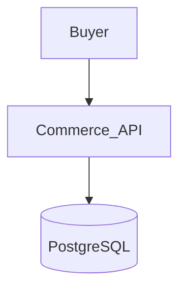

# Architecture

Meridian is a multi-tenant clinical supply control plane. Clinics order supplies against contract prices. The domain has tenants, catalogs, stock, orders, a ledger, and approvals. It has no patient, prescription, or clinical record.

Postgres is the system of record. MongoDB will hold rebuildable documents. RabbitMQ will carry the saga. The agent proposes writes, and a person approves them before the core commits. The AWS dev stack is Terraform in `infra/terraform` and is applied only while it is in use.

`POST /v1/orders` commits the order and an unpublished outbox row in one transaction. The relay and the saga are described in [saga.md](saga.md). Catalog documents and order timelines are rebuilt from Postgres, and catalog search uses pgvector; both are described in [projections.md](projections.md). The identity port, the agent, and AWS are the later phases. Decisions are in `docs/adr/`. The transaction itself is described in [place-order.md](place-order.md).
