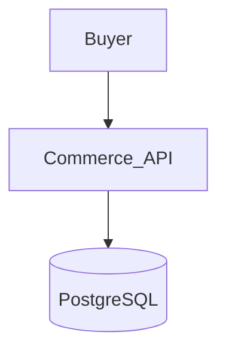

# Architecture

Meridian is a multi-tenant clinical supply control plane. Clinics order supplies against contract prices. The domain has tenants, catalogs, stock, orders, a ledger, and approvals. It has no patient, prescription, or clinical record.

Postgres is the system of record. MongoDB will hold rebuildable documents. RabbitMQ will carry the saga. The agent will propose writes, and a person will approve them before the core commits.

Phase 0 is the write in that diagram. `POST /v1/orders` commits the order and an unpublished outbox row in one transaction. The relay, the saga, the projections, the identity port, the agent, and AWS are the later phases. Decisions are in `docs/adr/`. The transaction itself is described in [place-order.md](place-order.md).
