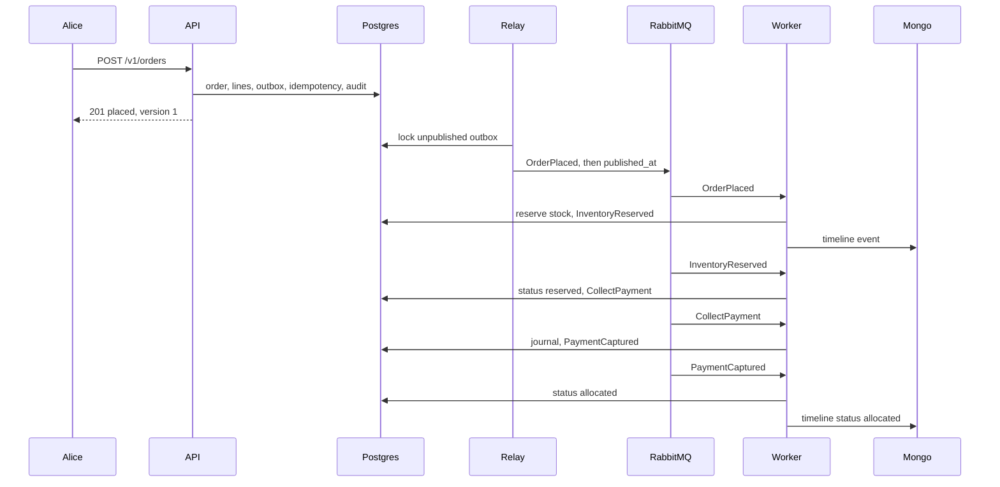

# The positive order flow

This is the path where a buyer places an order, stock is available, and payment captures. The order ends `allocated`. Decline, insufficient stock, and the reservation timeout are other paths.

Alice is a buyer at one clinic. Her Keycloak token carries that clinic as `tenant_id` (`6f1e2c4a-8b3d-4e5f-9a70-1c2d3e4f5a6b`). She is ordering two units of `GLV-100` at 499 cents each, so the order total is 998 cents. Someone at that clinic has already received stock, so on-hand minus reserved is at least 2. The default warehouse is `00000000-0000-4000-8000-000000000001`.



## 1. Alice places the order

She sends `POST /v1/orders` with `Authorization: Bearer <token>` and an `Idempotency-Key`. The body is USD, and it omits `paymentOutcome`, so the API stores `capture`.

The API checks the token, then runs one Postgres transaction as `meridian_app` with her tenant set:

- Insert the order at status `placed`, version `1`.
- Insert the lines.
- Insert an `OrderPlaced` outbox row with `published_at` null.
- Insert the idempotency row, keyed by her tenant and the idempotency key, storing this response.
- Insert an audit row, action `order.place`, actor the token's `sub`.

The HTTP response is `201`:

```json
{
  "orderId": "<uuid>",
  "tenantId": "6f1e2c4a-8b3d-4e5f-9a70-1c2d3e4f5a6b",
  "status": "placed",
  "version": 1
}
```

That body is what this key will return forever, including after the order has moved on. Alice learns the later status from `GET /v1/orders/<orderId>`.

No message is on RabbitMQ yet. If the process dies before this commit, there is no order. If it dies after the commit, the order and the outbox row are both there.

A second door reaches this same transaction. The agent may propose an approval, and a person approves it in the inbox. `POST /v1/approvals/:id/execute` calls this place-order path with idempotency key `approval:<id>` and `paymentOutcome` `capture`. The price on that approval came from `catalog_products`. From the commit onward, both doors are this flow.

## 2. The relay publishes `OrderPlaced`

The worker polls about every 200ms. The relay locks unpublished outbox rows with `FOR UPDATE SKIP LOCKED`, publishes `OrderPlaced` on the `commerce.order` exchange, waits for the broker confirm, and only then sets `published_at`. The routing key is `order.placed`. The queue `commerce.order.process` receives it.

The relay runs as the table owner, not as `meridian_app`, because it has to see every tenant.

## 3. Inventory reserves the stock

The worker handles `OrderPlaced` as the inventory consumer. In one transaction it inserts the inbox row `(inventory, message id)` and reserves the two units: `stock_items.reserved` increases by 2, and a reservation row is inserted with status `held`. On-hand does not change. It also appends an `InventoryReserved` outbox row for the same order.

The order status is still `placed`. Reserving stock does not move the saga. The process manager does that when it sees `InventoryReserved`.

After the transaction commits, the worker appends an `OrderPlaced` event to the Mongo timeline and acknowledges the message. The timeline status is still `placed`, because that is what the order row says.

The relay's next poll publishes `InventoryReserved`.

## 4. The process manager asks for payment

The worker handles `InventoryReserved` as the process manager. The order is `placed`, so the decision is to move it to `reserved` and emit `CollectPayment` for 998 cents with outcome `capture`. One transaction inserts the inbox row `(process-manager, message id)`, updates the order to version `2`, writes the `CollectPayment` outbox row, and audits `order.transition` with actor `worker`.

The timeline then records `InventoryReserved` and shows status `reserved`. The relay publishes `CollectPayment` with routing key `billing.collect`.

## 5. Billing captures and writes the journal

The worker handles `CollectPayment` as the billing consumer. The payment port returns `captured` because the order's outcome is `capture`. One transaction inserts the inbox row `(billing, message id)`, writes a balanced journal, and appends `PaymentCaptured`.

The two postings sum to zero:

| Account               | Amount |
| --------------------- | ------ |
| `accounts_receivable` | `998`  |
| `sales_revenue`       | `-998` |

The order status is still `reserved`. The timeline records `CollectPayment` with that status. The relay publishes `PaymentCaptured`.

## 6. The order is allocated

The worker handles `PaymentCaptured` as the process manager. The order is `reserved`, so the decision is `allocated` at version `3`, with no further command. The same transaction audits `order.transition`. There is nothing new to publish.

The worker then updates the Mongo timeline. Its status is `allocated`, and its events include `OrderPlaced`, `InventoryReserved`, `CollectPayment`, and `PaymentCaptured`. Each event is stored once per message id, so a redelivery does not add a second copy.

Alice's `GET /v1/orders/<orderId>` now returns `allocated`, version `3`, and `rejectionReason` null. `GET /v1/orders/<orderId>/timeline` returns the projection. `GET /v1/audit` shows `order.place` from her token, then `order.transition` from the worker. Bob's token gets `404` for the order and the timeline. His tenant never had this row.

Unpublished outbox rows for this order are gone. Reserved stock stays at 2 for as long as the reservation is `held`.
